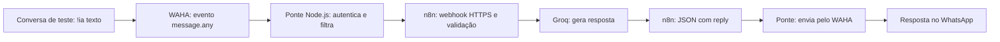

# Portaria Fácil — Checkpoint 01

Projeto do Grupo 6 no Bootcamp Software Engineering Project, MBA em Engenharia de Software da Faculdade Impacta.

O Portaria Fácil propõe organizar o recebimento, o aviso ao morador e a retirada de encomendas em condomínios, com leitura assistida de etiquetas por IA e conferência humana.

**Para o professor:** os documentos estão disponíveis nas [PR #1 — Organização do POD](https://github.com/CaioScan/PortariaFacil/pull/1) e [PR #2 — Produto](https://github.com/CaioScan/PortariaFacil/pull/2), abertas e aguardando revisão. O [PDF consolidado](https://github.com/CaioScan/PortariaFacil/blob/docs/checkpoint-01-produto/docs/produto/Portaria-Facil-Checkpoint-01.pdf) reúne a proposta escrita.

**Marco:** PODs formados, repositório criado, problema escolhido.
**Status:** Grupo 6 identificado; Caio confirmado como Tech Lead e endereço do repositório informado. Demais papéis e aprovação do tema ainda pendentes.

**Atualização técnica:** o estudo de integração WhatsApp com **WAHA + n8n + Groq** foi incorporado à main pela [PR #3](https://github.com/CaioScan/PortariaFacil/pull/3). Veja o [fluxo e a configuração](#9-integração-whatsapp--waha--n8n).

## 1. Proposta para apresentação

O Portaria Fácil pretende melhorar o recebimento e a retirada de encomendas em condomínios. Hoje, no cenário relatado, o porteiro anota a chegada em um caderno, tenta avisar pelo interfone e coleta a assinatura na retirada. Quando o morador está fora, o aviso pode não chegar e depende de uma nova tentativa do porteiro.

Nossa proposta é centralizar o registro, o aviso ao apartamento e a confirmação da retirada. Para adequar a proposta ao desafio de IA da disciplina, propomos investigar a leitura de etiquetas por imagem: a IA sugere os dados da encomenda e o porteiro confere antes de registrar. A hipótese é reduzir o trabalho de transcrição e as falhas de comunicação sem retirar a responsabilidade humana pela conferência.

## 2. POD e responsabilidades

Nome do POD: **Grupo 6**, com três integrantes, conforme a composição prevista no slide 64.

Encontro do grupo: [Google Meet](https://meet.google.com/oxt-gdda-arf).
Tema proposto: **Portaria Fácil — gestão de encomendas em condomínios**. Ratificação pelo grupo ainda pendente.

| Integrante | Papel | Usuário GitHub |
| --- | --- | --- |
| Caio Scandiuzzi Valente Coimbra | Tech Lead | CaioScan |
| Aldenir Rodrigues Almeida | A definir pelo grupo | A informar |
| Renildo da Silva Santos Junior | A definir pelo grupo | A informar |

Responsabilidades dos papéis; Product Owner e Quality & Ops ainda a distribuir:

| Papel | Responsabilidade |
| --- | --- |
| Product Owner | Problema, PRD, histórias e validação com usuários |
| Tech Lead | Regras do agente e arquitetura |
| Quality & Ops | Qualidade, CI, deploy e métricas |

Todos participam das decisões, operam o agente e revisam PRs. Em aula, o trabalho será em mob, com rodízio de operador a cada 15–20 minutos. Cada PR precisa de revisão de outro integrante, e o limite será de duas PRs abertas simultaneamente, conforme os slides 62 e 67.

## 3. Problema escolhido — proposta para ratificação

**Como reduzir o esforço de registrar encomendas e garantir que o morador possa tomar conhecimento da chegada, mesmo ausente, mantendo um histórico confiável da retirada?**

Públicos envolvidos:

- Porteiro: registra a chegada, avisa e entrega a encomenda.
- Morador: precisa saber que a encomenda chegou e acompanhar a retirada.
- Síndico ou administrador: organiza os acessos e acompanha os registros.

O relato inicial é uma evidência de contexto, não uma pesquisa concluída. Frequência do problema, volume de encomendas, tempo gasto e disposição de pagamento ainda precisam ser validados.

## 4. Repositório

Nome do repositório: **PortariaFacil**.

- Repositório: [CaioScan/PortariaFacil](https://github.com/CaioScan/PortariaFacil).
- URL do MVP: **ainda não publicada para o projeto acadêmico**.
- Usuário GitHub do professor: **a informar para solicitação de revisão**.

Endereço do repositório fornecido por Caio. O acesso dos integrantes e do professor, a proteção da main e os checks de CI ainda precisam ser confirmados.

Estrutura prevista no slide 70:

```text
README.md
AGENTS.md
docs/
  produto/
  specs/
  adr/
  diario/
  pitch/
architecture/
prototype/
evals/
src/
.github/
```

Os documentos acadêmicos estão organizados em duas PRs mantidas abertas para revisão humana: organização do POD e proposta de produto. Este README e o estudo WAHA da PR #3 já estão na main. Os documentos das PRs #1 e #2 permanecem nas respectivas branches até a revisão. As regras iniciais do agente estão no `AGENTS.md` da PR de organização.

## 5. Material preparado

- [Lean Canvas](https://github.com/CaioScan/PortariaFacil/blob/docs/checkpoint-01-produto/docs/produto/lean-canvas.md)
- [Hipótese de valor](https://github.com/CaioScan/PortariaFacil/blob/docs/checkpoint-01-produto/docs/produto/hipotese.md)
- [PRD v0 com seis pilares](https://github.com/CaioScan/PortariaFacil/blob/docs/checkpoint-01-produto/docs/produto/prd-v0.md)
- [PDF consolidado](https://github.com/CaioScan/PortariaFacil/blob/docs/checkpoint-01-produto/docs/produto/Portaria-Facil-Checkpoint-01.pdf)
- [AGENTS.md v0](https://github.com/CaioScan/PortariaFacil/blob/docs/checkpoint-01-organizacao/AGENTS.md)
- [Diário do checkpoint](https://github.com/CaioScan/PortariaFacil/blob/docs/checkpoint-01-organizacao/docs/diario/checkpoint-01.md)
- [PRs para revisão](https://github.com/CaioScan/PortariaFacil/pulls)

Os links apontam para as branches das PRs e permitem consultar os materiais antes do merge. O PDF registra a proposta anterior à publicação; o estado atual da revisão deve ser consultado nas PRs.

## 6. Relação com o projeto existente

Existe um protótipo anterior do Portaria Fácil, com painel web e app de morador em .NET MAUI. Ele é uma referência de aprendizado; o grupo precisa alinhar com o professor as condições de reaproveitamento. Não deve ser apresentado como código desenvolvido durante o bootcamp.

O fluxo de aviso discutido até aqui usa consulta periódica e popup no app aberto quando muda a versão da notificação. Isso não comprova entrega de push com o app fechado. A leitura de etiquetas por IA é uma proposta nova, ainda sem implementação ou validação.

O curso também exige fluxo em URL pública em uma etapa posterior. A dependência exclusiva de instalação de APK precisa ser avaliada no checkpoint de produto.

## 7. Decisões necessárias para fechar hoje

- [x] Identificar os três integrantes do Grupo 6, conforme imagem enviada.
- [x] Confirmar Caio Scandiuzzi Valente Coimbra como Tech Lead.
- [ ] Distribuir e confirmar Product Owner e Quality & Ops.
- [ ] Ratificar o problema escolhido.
- [ ] Revisar Lean Canvas, hipótese e PRD v0.
- [ ] Avaliar a proposta de IA: avisos automáticos por regras, isoladamente, não caracterizam IA.
- [x] Registrar a URL do repositório informada por Caio.
- [ ] Adicionar os integrantes e o professor com os acessos adequados.
- [ ] Configurar proteção da main, revisão por outro integrante e exigência de CI, conforme slide 71; a configuração não foi executada nesta entrega.
- [x] Publicar os documentos em duas PRs para revisão.
- [ ] Revisar e integrar as PRs após aprovação humana.
- [ ] Registrar a revisão humana no diário.
- [ ] Criar a tag `checkpoint-01` no commit aprovado, dentro do prazo da aula.

## 8. Referências do material da disciplina

Fonte: **Bootcamp · Software Engineering Project — Aula 01 (1).pdf**, Prof. Marcus Vinicius Almeida Silva.

| Slides | Uso neste documento |
| --- | --- |
| 8 | Marco do encontro 01 |
| 17, 43–45 | IA na proposta de valor e desafio do produto |
| 64–67 | Composição, papéis e regras do POD |
| 69–71 | Repositório, estrutura, revisão e tags |
| 72, 83–84 | Entregáveis detalhados do checkpoint 01 |

O slide 8 é o resumo do marco. O detalhamento dos slides 72 e 84 inclui os documentos de produto preparados aqui. O AI Canvas completo e o PRD v1 pertencem ao checkpoint 02.

## 9. Integração WhatsApp — WAHA + n8n

O estudo em [`whatsapp-estudos-export/`](whatsapp-estudos-export/) implementa uma ponte para receber comandos do WhatsApp via WAHA, processá-los em um workflow n8n com Groq e devolver a resposta à conversa autorizada. A PR #3 foi integrada em 16/10/2026 por solicitação do autor.

### Fluxo implementado



| Componente | Responsabilidade |
| --- | --- |
| WAHA | Vincula a sessão WhatsApp, emite eventos e disponibiliza o envio de texto. |
| Ponte Node.js | Valida o segredo do webhook, seleciona comandos `!ia`, filtra origem e horário, limita chamadas e encaminha apenas o texto ao n8n. |
| n8n | Recebe o texto por webhook com Header Auth, valida a entrada, executa a cadeia de IA e responde com JSON. |
| Groq | Fornece o modelo de linguagem utilizado pelo workflow. |

Por padrão, o bot está desativado e, quando habilitado sem grupo configurado, aceita comandos somente na conversa consigo mesmo. `TEST_GROUP_ID` permite autorizar explicitamente um grupo de teste. Exemplo de comando: `!ia explique o que é uma API`.

### Arquivos e instalação

- [Guia completo de instalação e operação](whatsapp-estudos-export/waha/README.md).
- [Workflow n8n para importar](whatsapp-estudos-export/n8n-workflow.json).
- [Docker Compose do WAHA e da ponte](whatsapp-estudos-export/waha/compose.yaml).
- [Exemplo das variáveis de configuração](whatsapp-estudos-export/waha/bridge.env.example).
- [Código da ponte](whatsapp-estudos-export/waha/bridge.mjs) e [testes](whatsapp-estudos-export/waha/bridge.test.mjs).

1. Preparar Docker com containers Linux e a configuração privada conforme o guia.
2. Importar `n8n-workflow.json` no n8n. O arquivo vem desativado e sem credenciais.
3. Configurar Header Auth no webhook (`X-Study-Key`) e a credencial Groq no nó do modelo. Conferir a disponibilidade do modelo na conta antes do teste.
4. Configurar na ponte a URL HTTPS do webhook publicado, as chaves independentes e o destino de teste.
5. Vincular a sessão `default` do WAHA por QR Code e configurar o evento `message.any` para `http://bridge:3001/events`, com `X-Relay-Key`.
6. Após conferir a configuração, habilitar `BOT_ENABLED=true` e testar no destino autorizado, seguindo o guia.

Credenciais e sessões ficam fora dos arquivos versionados. O Compose publica o WAHA apenas em `127.0.0.1:3000`; a ponte usa a rede interna do Docker. Se o backend do protótipo também usar a porta 3000, será necessário resolver esse conflito antes de executar ambos no mesmo computador.

### Estado da validação e relação com o Portaria Fácil

- Cinco testes automatizados da seleção de comandos passaram, e a sintaxe da ponte foi verificada.
- O JSON do workflow, as referências entre nós e a validação de entrada foram conferidos localmente.
- A integração ponta a ponta com serviços ativos ainda não foi validada nesta publicação; não foram enviadas mensagens durante o commit ou merge.
- O estudo ainda não está conectado ao cadastro de encomendas, à aprovação do morador ou ao botão de reaviso do Portaria Fácil. Essa ligação é uma etapa futura.
- O uso de IA aqui é para respostas ao comando de estudos; a leitura de etiquetas proposta no produto continua pendente.

Os limites de chamadas e a deduplicação da ponte ficam em memória e reiniciam com o processo. WAHA é a tecnologia utilizada neste estudo; o documento de referência `WHATSAPP_BUSINESS_MCP.md` trata de outra integração e não indica que a Cloud API oficial tenha sido implementada.
