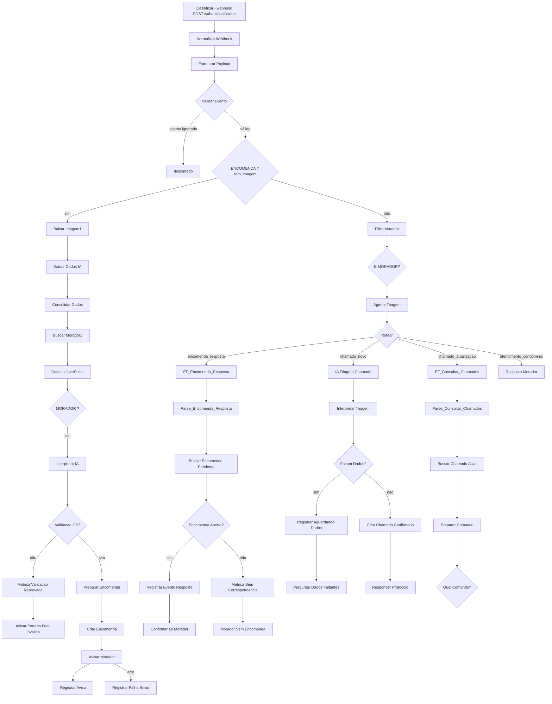

# Comportamento do n8n — `assistent_service_n8n.json`

Documento descritivo do comportamento do workflow `assistent_service_n8n` (nome interno **"Registro Encomenda"**).
Foi produzido a partir da leitura do arquivo [assistent_service_n8n.json](assistent_service_n8n.json) e do schema em [schema_assistent_n8n](schema_assistent_n8n).
Descreve o que está no arquivo; não substitui um teste funcional executado.

- Workflow ativo: `active: true`
- Ordem de execução: `v1` / `binaryMode: separate`
- Instância: n8n em Docker (`schedule_n8n/docker-compose.yml`), WAHA e PostgreSQL locais
- Integrações: WAHA (WhatsApp), PostgreSQL, Redis (memória de IA), Google Gemini (modelo de linguagem)

---

## 1. Visão geral

É um único workflow acionado por webhook que recebe eventos do WhatsApp (via WAHA) e decide o que fazer de acordo com o conteúdo da mensagem. Ele atende três frentes:

1. **Encomenda recebida** — quando chega uma foto de etiqueta, o assistente lê os dados, identifica o morador, registra a encomenda e avisa o morador.
2. **Resposta de encomenda** — quando o morador responde `OK`/`LI` (leitura) ou `RECEBI`/`RETIREI` (retirada), o sistema confirma e baixa a encomenda.
3. **Chamados** — abertura de chamado (triagem com IA), consulta de status e comandos de ciclo de vida (`CONFIRMO`, `STATUS`, `RESOLVIDO`, `REABRIR`, `CANCELAR`) por parte do morador ou do responsável da portaria.

Fluxo resumido:

```
WAHA (evento) → Classificar (webhook)
   → Normalizar Webhook → Estruturar Payload → Validar Evento
       ├─ (evento irrelevante) → descartado
       └─ (válido)
           ├─ tem imagem → OCR da etiqueta → registra encomenda → avisa morador
           └─ sem imagem → identifica morador → Agente Triagem (IA) → roteia intenção
                                                                 ├─ encomenda_resposta
                                                                 ├─ chamado_novo
                                                                 ├─ chamado_atualizacao
                                                                 └─ atendimento_condominio
```

Diagrama (Mermaid):



---

## 2. Entrada e normalização

### 2.1 `Classificar` (webhook)
Único ponto de entrada. Recebe `POST` no caminho **`waha-classificador`**. O WAHA é configurado para enviar os eventos do WhatsApp para este webhook.

### 2.2 `Normalizar Webhook` (Set)
Extrai e padroniza os campos do payload do WAHA, entre eles:

| Campo | Origem no payload |
|---|---|
| `session` | `body.session` |
| `chat_id` | `body.payload.from` |
| `event` | `body.event` |
| `from_me` | `body.payload.fromMe` |
| `mime_type` | `body.payload.media.mimetype` |
| `media_url` | `body.payload.media.url` (substitui `localhost` por `waha`) |
| `temImagem` | `media.mimetype` inicia com `image/` |
| `mensagem_de_grupos` | `body.payload._data.Info.IsGroup` |
| `chamado_responsavel_nome` | `payload._data.Info.PushName` |
| `chamado_responsavel_whatsapp` | `payload._data.Info.SenderAlt` (primeiros 13 caracteres) |
| `chamado_relato` | `body.payload.body` |
| `representante` / `representante_whatsapp` | `body.me.pushName` / `body.me.id` (13 caracteres) |

Também inicializa com valores vazios os campos de `morador_*`, `encomenda_*` e `chamado_*`.

### 2.3 `Estruturar Payload` (Code)
Monta o objeto base unificado `{ contexto, morador, encomenda, chamado }`, com `morador`, `encomenda` e `chamado` vazios (preenchidos mais adiante). Normaliza telefone (apenas dígitos) e sinaliza `enviar_apenas_responsavel`.

### 2.4 `Validar Evento` (IF — filtro)
Usa combinador **OR**: se **qualquer** condição for verdadeira, o evento é considerado irrelevante e **descartado** (saída verdadeira não segue para nenhum nó). São descartados:

- mensagens de grupo (`mensagem_de_grupos`)
- eventos de `ack`
- `chat_id` contendo `@newsletter`, `@g.us` ou `@broadcast`
- áudios (`media_url` com `.oga`, `.ogg` ou `.mp3`)
- mensagens enviadas pelo próprio número (`from_me`)

Somente eventos **válidos** seguem pela saída falsa para `ENCOMENDA ?`.

---

## 3. Ramo A — Encomenda recebida (mensagem com imagem)

### 3.1 `ENCOMENDA ?` (IF)
Verifica `contexto.tem_imagem`.
- **Sim** → segue para o tratamento de foto de etiqueta.
- **Não** → vai para o ramo de triagem de texto (seção 4).

### 3.2 Leitura da etiqueta
1. `Baixar Imagem1` (HTTP Request) — baixa a mídia em `media_url` enviando o header `X-Api-Key` do WAHA; resposta lida como arquivo; com nova tentativa em caso de falha.
2. `Extrair Dados IA` (Agente LangChain + Google Gemini + `Structured Output Parser`) — atua como OCR da etiqueta. Extrai: `destinatario_nome`, `destinatario_apartamento`, `destinatario_bloco`, `destinatario_andar` (apenas dígitos), `destinatario_endereco`, `dados_remetente` e `imagem_legivel`. Regra explícita: **não inventar** dados ausentes; campo vazio quando não houver informação.
3. `Consolidar Dados` (Code) — junta a extração da IA com o payload base, preserva UUIDs/datas e anexa o binário da imagem.

### 3.3 Identificação do morador
4. `Buscar Morador1` (Postgres) — busca em `moradores` (`ativo = TRUE`) em cascata: chave composta (bloco+andar+apartamento) → bloco+apartamento → somente apartamento → nome do destinatário (`LIKE`). Retorna até 5 linhas.
5. `Code in JavaScript` (Code) — decide o morador (uma linha = confirmado; mais de uma = ambíguo). Gera `id` (UUID) e `protocolo` no formato `ENC-AAAAMMDD-XXXX`. Define `status`: `aguardando_retirada` (morador encontrado) ou `pendente_identificacao` (não encontrado) e marca `contexto.morador_encontrado`.
6. `MORADOR ?` (IF) — segue **somente** se o morador foi encontrado e está ativo. Caso contrário, o fluxo para (nenhuma ação é tomada).

### 3.4 Validação e gravação
7. `Interpretar IA` (Code) — parseia a saída da IA e calcula `validacao_ok = (eh_encomenda) && (legivel || imagem_legivel)`.
8. `Validacao OK?` (IF):
   - **Não** → `Metrica Validacao Reprovada` (registra métrica `validacao_reprovada`) → `Avisar Portaria Foto Invalida` (envia mensagem pedindo nova foto nítida com nome, bloco e apartamento).
   - **Sim** → `Preparar Encomenda` (Code): gera `codigo` (`ENC-xxxxxx`) e `codigo_retirada` (4 dígitos), normaliza o WhatsApp do morador (prefixo `55`).
9. `Criar Encomenda` (Postgres) — insere em `encomendas` com `status = 'AGUARDANDO_RETIRADA'`, retornando `protocolo` e `unidade`.
10. `Avisar Morador` (WAHA) — envia mensagem ao morador (`<whatsapp>@c.us`) informando a chegada, o código e as opções: responder `OK`/`LI` (leitura) ou `RECEBI`/`RETIREI` (retirada).
    - Sucesso → `Registrar Aviso` (atualiza `updated_at` e registra métrica `aviso_disponibilizado`).
    - Erro → `Registrar Falha Envio` (grava `erro_envio` e métrica `falha_envio`).

---

## 4. Ramo B — Triagem de texto (mensagem sem imagem)

1. `Filtra Morador` (Postgres) — `SELECT ... FROM moradores WHERE whatsapp = <remetente> AND ativo = true`.
2. `E MORADOR?` (IF) — segue apenas se o remetente for um morador ativo cadastrado. Números não cadastrados são ignorados.
3. `Agente Triagem` (Agente LangChain + Google Gemini + memória Redis `Memoria Triagem`, TTL 3600 s, janela de 6 mensagens, `Triagem Output Parser`) — classifica a intenção:
   - `encomenda_resposta`, `chamado_novo`, `chamado_atualizacao` ou `atendimento_condominio`;
   - sub-ação `acao_encomenda` (`confirmar_leitura`, `confirmar_retirada`, `consultar_encomenda`, `nenhuma`), `codigo_retirada`, `resposta_morador` e `confianca`.
   - Regras de negócio no prompt: confirmações como "ok/li/ciente/recebi/retirei" **sempre** vão para `encomenda_resposta`; menções a "chamado/problema/vazamento/manutenção" **sempre** vão para `chamado_novo`; `atendimento_condominio` fica restrito a saudações e dúvidas gerais.
4. `Rotear` (Switch) — encaminha para uma das quatro rotas conforme `intencao`.

### 4.1 Rota `encomenda_resposta`
- `EF_Encomenda_Resposta` (Set) → `Parse_Encomenda_Resposta` (Code): define a ação — `confirmar_retirada` quando o texto indica "recebi/retirei/peguei"; caso contrário `confirmar_leitura`.
- `Buscar Encomenda Pendente` (Postgres): procura encomenda `AGUARDANDO_RETIRADA` pela unidade (bloco/andar/apartamento) ou pelo WhatsApp; se não achar, usa um fallback (última pendente).
- `Encomenda Aberta?` (IF, com base em `protocolo`):
  - **Sim** → `Registrar Evento Resposta` (marca `RETIRADA` e `data_retirada` quando a ação é retirada) → `Confirmar ao Morador` (confirma leitura ou retirada).
  - **Não** → `Metrica Sem Correspondencia` (métrica `resposta_sem_encomenda`) → `Morador Sem Encomenda` (avisa que não há encomenda pendente).

### 4.2 Rota `chamado_novo`
- `IA Triagem Chamado` (Agente LangChain + Google Gemini + memória Redis `Memoria Chamado` + `Structured Output Parser1`) — consolida o relato e decide se já é possível abrir o chamado. Preenche `resumo` (≤ 20 palavras), `categoria` (manutencao/limpeza/seguranca/barulho/outros), `prioridade` (baixa/media/alta) e `dados_faltantes`. Bloco/apartamento nunca entram em `dados_faltantes`.
- `Interpretar Triagem` (Code) → `Faltam Dados?` (IF — `dados_faltantes.length > 0`):
  - **Sim** → `Registrar Aguardando Dados` (Postgres: cria/atualiza chamado com `status = 'aguardando_dados'`) → `Perguntar Dados Faltantes` (WAHA: pede a descrição do problema). Erro de envio → `Metrica Falha Envio Chamado`.
  - **Não** → `Criar Chamado Confirmado` (Postgres: cria/atualiza chamado com `status = 'ABERTO'` e define o responsável ativo mais antigo) → `Responder Protocolo` (WAHA: envia número do protocolo). Erro de envio → `Metrica Falha Envio Chamado`.

### 4.3 Rota `chamado_atualizacao`
- `EF_Consultar_Chamados` (Set) → `Parse_Consultar_Chamados` (Code): extrai `chatId`, `morador_whatsapp`, unidade, texto e, se houver, um protocolo UUID presente na mensagem.
- `Buscar Chamado Ativo` (Postgres): localiza o chamado por protocolo ou por unidade/WhatsApp, priorizando status ativos (`ABERTO`, `EM_ANDAMENTO`, `AGUARDANDO_DADOS`, `REABERTO`).
- `Preparar Comando` (Code): interpreta o comando por palavras-chave → `sem_chamado`, `status`, `confirmo`, `resolvido`, `reabrir`, `cancelar` ou `fallback`.
- `Qual Comando?` (Switch, com saída de fallback) direciona:

| Comando | Nós | Efeito |
|---|---|---|
| Sem Chamado | `Chamado Nao Encontrado` (WAHA) | Avisa que não há chamado vinculado |
| Status | `Buscar Ultimo Evento` (Postgres) → `Responder Status` (WAHA) | Envia protocolo, unidade, resumo, status e responsável |
| Confirmo | `Confirmar Chamado` (Postgres) → `Avisar Responsavel Confirmacao` (WAHA) | Status → `em_andamento`, `confirmado = true` |
| Resolvido | `Resolver Chamado` (Postgres) → `Avisar Morador Resolvido` (WAHA) | Status → `RESOLVIDO`, define `data_fechamento` |
| Reabrir | `Reabrir Chamado` (Postgres) → `Avisar Responsavel Reabertura` (WAHA) | Status → `REABERTO`, limpa `data_fechamento` |
| Cancelar | `Cancelar Chamado` (Postgres) → `Avisar Morador Cancelado` (WAHA) | Status → `CANCELADO`, define `data_fechamento` |
| fallback | `Comando Nao Reconhecido` (WAHA) | Orienta os comandos válidos |

Além das mudanças de status, as queries `Confirmar/Resolver/Reabrir/Cancelar` gravam métrica `status_alterado` em `eventos_metricas`. Falhas de envio nesses avisos caem em `Metrica Falha Envio Chamado`.

### 4.4 Rota `atendimento_condominio`
- `Resposta Morador` (WAHA) — envia ao morador o texto `resposta_morador` gerado pelo `Agente Triagem` (saudações e dúvidas gerais).

---

## 5. Banco de dados e métricas

O workflow usa o PostgreSQL do `docker-compose.yml`. Tabelas envolvidas (ver [schema_assistent_n8n](schema_assistent_n8n)):

- `moradores` — chave primária composta (bloco, andar, apartamento), WhatsApp único.
- `responsaveis` — funcionários da portaria (nome, WhatsApp, `chat_id`, cargo, ativo).
- `encomendas` — protocolo único, código de retirada, status (`AGUARDANDO_RETIRADA` → `RETIRADA`), dados do destinatário/remetente, mídia.
- `chamados` — protocolo único, status, relato, resumo, responsável, dados faltantes.
- `eventos_metricas` — métricas registradas pelo fluxo.

Status de `chamados` observados: `ABERTO`, `em_andamento`, `aguardando_dados`, `RESOLVIDO`, `CANCELADO`, `REABERTO`.

Métricas gravadas: `resposta_sem_encomenda`, `aviso_disponibilizado`, `falha_envio`, `validacao_reprovada`, `status_alterado`.

Há também o nó avulso `Execute a SQL query` (Postgres), **sem conexões**, que cria o schema completo (`moradores`, `responsaveis`, `encomendas`, `chamados`, função/triggers de `updated_at`) e devolve o payload como JSON. Aparenta ser utilitário de inicialização manual do banco, não fazendo parte do fluxo acionado pelo webhook.

---

## 6. Credenciais e integrações

- **Postgres account** — banco de dados (`DB_POSTGRESDB_*` no compose).
- **WAHA account** — envio de mensagens e download de mídia (header `X-Api-Key`).
- **Redis account** — memória das IAs (`Memoria Triagem` e `Memoria Chamado`).
- **Google Gemini (PaLM) Api account** — modelos usados por `Agente Triagem`, `Extrair Dados IA` e `IA Triagem Chamado`.

> Por regra do projeto, os valores de credenciais (chave da API do WAHA, senhas do Postgres/Redis, tokens) não são reproduzidos neste documento.

---

## 7. Observações e limites

- O workflow está marcado como ativo e depende de WAHA, PostgreSQL e Redis em execução (ver `schedule_n8n/docker-compose.yml`).
- Pontos de término silencioso: eventos descartados em `Validar Evento`, morador não cadastrado em `E MORADOR?` e morador não encontrado/ambíguo em `MORADOR ?` — nesses casos nenhuma mensagem é respondida.
- `Estruturar Payload` procura o nó `Extrai dados Webhook`, que não existe neste arquivo; o código trata isso com fallback para a própria entrada.
- Detalhes de layout/posição dos nós no canvas não foram documentados por não afetarem o comportamento.
